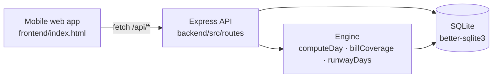

<div align="center">

# EarnShield

**A money shield for drivers whose income changes every day.**

Log what you earned and what you spent today. EarnShield tells you how much is safe to spend, how much to keep for bills, and how much to save for slow days — in English, हिन्दी and ಕನ್ನಡ.

[Live demo](#live-demo) · [Features](#features) · [How it works](#how-it-works) · [Run locally](#run-locally) · [API](#api) · [Team](#team)

</div>

---

## The problem

Auto and cab drivers in Bengaluru earn a different amount every day. Rent, the auto-loan EMI, school fees and the phone recharge are not different every day. A good day gets spent, a slow day goes on credit, and a bad month — a puncture, an accident, a week of rain — turns into debt.

Banks and budgeting apps assume a fixed salary. Drivers don't have one.

## The solution

EarnShield turns each day's earnings into three simple numbers, with a plain-language reason for each:

| | What it is |
|---|---|
| **Bills** | Money set aside for upcoming bills (rent, EMI, school fees, recharge) |
| **Vault** | Savings that build a runway for slow days and emergencies |
| **Safe to spend** | What the driver can spend today without hurting the first two |

The driver enters two things — earnings and costs — and gets one clear answer: **"Safe to spend today: ₹520."**

---

## Features

- **Daily split** — Net earnings are split between bills, vault and spending, and the split adapts to the day: more to bills on a slow day, more to the vault on a strong day.
- **"Why this split?"** — Every number comes with a short, plain explanation based on the driver's real figures.
- **Bills tracker** — Monthly bills with due dates. Money is set aside bill by bill (must-pay bills first, then the earliest due date), and each bill shows if it is covered, on track or at risk. Bills can be marked as paid.
- **Vault and runway** — The vault shows how many days the driver could cover essential costs with no income.
- **14-day check** — A clear yes/no on whether the next 14 days of bills and essential costs are safe, with the shortfall if not.
- **Emergency take-out** — Before taking money out of the vault, the driver sees what changes: runway before and after, and a plan to rebuild it.
- **Safety test** — A stress test that runs the driver's own bills through 1,000 simulated years, with and without EarnShield, in four hard scenarios: a normal year, a vehicle off the road for 10 days, two bad months, and both. Finishing all four unlocks the *Shield Master* badge.
- **Voice entry** — Say the amount instead of typing it, in English, Hindi or Kannada ("five hundred", "पाँच सौ", "ಐನೂರು", "2k"). Works in Chrome, Edge and Safari.
- **Three languages** — English, Hindi and Kannada across the whole app.
- **Summary export** — A shareable income summary (earned, work costs, net, days worked) that can be copied for a loan or lease application.
- **Mobile first** — Big text, high contrast, large tap targets, built for a phone.

## How it works



One Node server does everything: it serves the web app and the API on the same address, so there is nothing else to host.

### The daily split

For each day, `net = earnings − fuel − other costs`. The engine compares `net` with the average of the previous 14 days:

| Kind of day | Compared with recent average | Bills / Vault / Spend |
|---|---|---|
| Slow | below 0.8× | 50 / 20 / 30 |
| Normal | 0.8× to 1.3× (or no history) | 40 / 20 / 40 |
| Strong | above 1.3× | 35 / 30 / 35 |

Bills and vault are rounded to whole rupees, and spend is what remains, so the three parts always add up to the net. If net is zero or less, nothing is set aside.

### Bill coverage

Each unpaid bill has a target of what should be set aside. If the money protected for bills isn't enough for all of them, coverage shrinks from the lowest priority upward (optional bills first, then the latest due date). Status: **covered** (100%), **on-track** (50–99%) or **at-risk** (below 50%).

### Runway

`runway days = vault balance ÷ essential daily cost` (₹600 by default), rounded down.

---

## Tech stack

| Layer | Technology |
|---|---|
| Frontend | Vanilla HTML, CSS and JavaScript in one file — no build step |
| Backend | Node.js 22, Express 4 |
| Database | SQLite via `better-sqlite3` |
| Tests | Node's built-in test runner (28 tests) |
| Hosting | Render (one web service) |

## Project structure

```
EarnShield/
├── frontend/
│   └── index.html          # the whole mobile app (UI, 3 languages, safety test)
├── backend/
│   ├── src/
│   │   ├── server.js       # Express app; serves the API and the frontend
│   │   ├── db.js           # schema and demo seed data
│   │   ├── util.js         # shared helpers and response shapes
│   │   ├── engine/core.js  # computeDay, billCoverage, runwayDays
│   │   └── routes/         # dashboard, entries, explain, bills, reserve,
│   │                       # buffer, reports, settings, seed
│   └── test/               # engine, routes and contract tests
├── API.md                  # full API contract
├── CONTEXT.md              # background, rules and data model
└── STUBS.md                # known simplifications
```

---

## Run locally

**Requirements:** Node.js 22 (or any recent LTS) and npm.

```bash
git clone https://github.com/ch8thh/EarnShield.git
cd EarnShield/backend
npm install
npm start
```
## Website

https://earnshield.onrender.com/

Open **http://localhost:4000**. The app and the API run together.

The database is created and filled with demo data on first start, at `backend/data/earnshield.db` (git-ignored). Reset to the demo data at any time:

```bash
curl -X POST localhost:4000/api/seed/reset
```

| Setting | Default | Description |
|---|---|---|
| `PORT` | `4000` | Port the server listens on |
| `DB_PATH` | `backend/data/earnshield.db` | SQLite file (use `:memory:` for a throwaway database) |

### Run the tests

```bash
cd backend
npm test
```

> **Troubleshooting:** if you see *"was compiled against a different Node.js version"*, `node_modules` was installed under another Node version. Switch to Node 22, then run `rm -rf node_modules && npm install`.

---

## Demo data

The app starts with one demo driver, **Ravi Kumar**, with no login. "Today" is fixed at **20 November 2026**.

- Today: earned ₹1,850, fuel ₹420, other costs ₹130 → net ₹1,300 → bills ₹520, vault ₹260, safe to spend ₹520
- 14 earlier days with nets between ₹900 and ₹2,000
- Vault: ₹8,400 (target ₹15,000, buffer ₹3,000), which gives 14 days of runway
- Bills: Mobile recharge ₹299, Room rent ₹6,500, Auto loan EMI ₹4,200, School fees ₹1,800

### Suggested demo flow

1. Choose a language, and open **Home** — the safe-to-spend number and the 14-day check.
2. **Add earning** ₹1,000 (type it or say it), then **Add expense** (CNG ₹300) — watch the numbers change.
3. Open **Money** — the split, and **Why this split?**
4. Add a bill, and mark one as paid.
5. **Take out** ₹2,000 from the vault — see the runway before and after.
6. Open **Safety test** and run all four hard times to unlock the badge.

---

## API

Base URL: `/api` · JSON in and out · amounts in rupees · dates as `YYYY-MM-DD`. The full contract with example responses is in [`API.md`](API.md).

| Method | Route | Purpose |
|---|---|---|
| GET | `/dashboard` | Safe to spend, vault, runway, bills, variability, 14-day check |
| POST | `/entries` | Save a day's earnings and costs, and apply the split (re-posting a date replaces it) |
| GET | `/entries?from&to` | List saved days |
| GET | `/explain/:date` | The reasoning behind a day's split |
| GET · POST | `/bills` | List or create bills |
| PATCH · DELETE | `/bills/:id` | Edit or remove a bill |
| POST | `/bills/:id/pay` | Mark a bill as paid (any shortfall comes out of the vault) |
| GET | `/reserve` | Vault balance, target and history |
| POST | `/buffer/withdraw` | Simulate an emergency withdrawal (changes nothing yet) |
| POST | `/buffer/rebuild/accept` | Confirm the withdrawal and the rebuild plan |
| GET | `/reports/summary` | Income summary for a date range |
| GET | `/reports/export.csv` | The same data as CSV |
| GET · PUT | `/settings` | Language and preferences |
| POST | `/seed/reset` | Restore the demo data |
| GET | `/health` | Liveness check |

---

## Deployment

EarnShield runs as a single web service on [Render](https://render.com):

| Setting | Value |
|---|---|
| Root directory | `backend` |
| Build command | `npm install` |
| Start command | `npm start` |
| Environment variable | `NODE_VERSION=22` |

Every merge into `main` redeploys automatically.

**Notes for the free tier:**
- The service sleeps after about 15 minutes without traffic, so the first load can take up to a minute.
- The database is not persisted. Every restart returns to the demo data, which is what the demo needs.

## Live demo

> **https://\<add-your-render-link\>.onrender.com**
>
> The first load may take up to a minute while the free server wakes up.

---

## Limitations and next steps

This is a hackathon prototype. What is simplified, and what would come next:

- One demo driver, no sign-in. Next: phone-number login and one account per driver.
- The weather alert is a sample message. Next: a real forecast for the driver's area.
- Spending on the household is tracked in the browser only, not in the database.
- The vault setting `auto`/`manual` is saved but does not yet change the split.
- Voice entry uses the browser's speech recognition, so it needs Chrome, Edge or Safari, and an internet connection.
- Next: UPI and bank integration to log earnings automatically, SMS reminders before bills, and shareable income proof for loans.

See [`STUBS.md`](STUBS.md) for the full list of known simplifications.

---

## Team

| | Role |
|---|---|
| **C** ([@ch8thh](https://github.com/ch8thh)) | Frontend, engine and entries, product |
| **Y** ([@shaanisalive01-lab](https://github.com/shaanisalive01-lab)) | Bills and vault logic, reports, deployment |

Built for a hackathon in November 2026.
